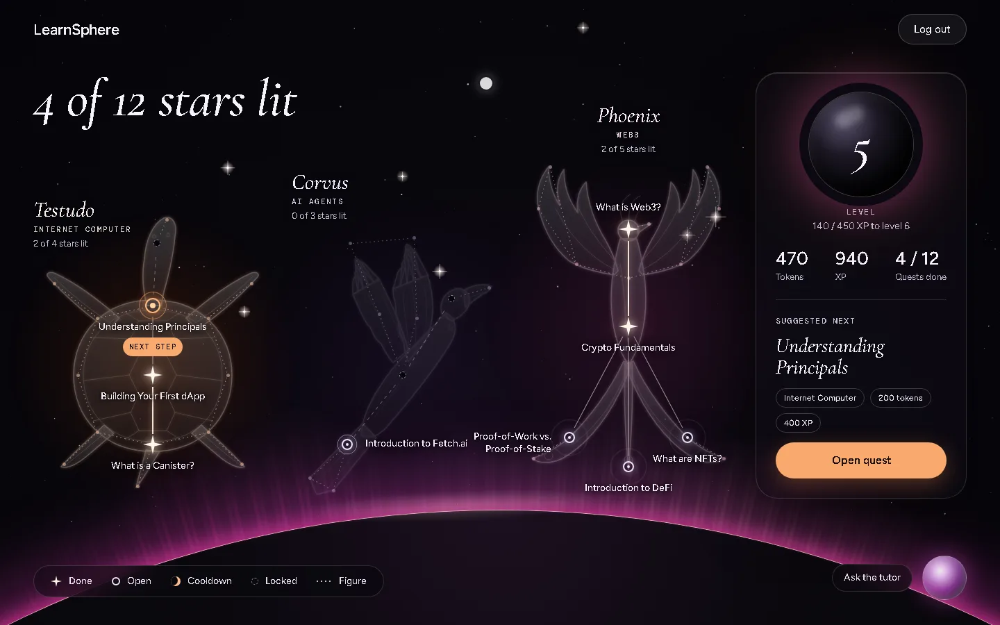

# LearnSphere

**A learn-to-earn quest game for Web3 beginners, built on the Internet Computer.**

Each quest is a star in a night sky. You read one real page (ICP docs, Fetch.ai docs,
ethereum.org and others), answer three questions, and the star lights up. The quests form three
constellations: Testudo the Turtle (the Internet Computer), Corvus the Raven (AI agents) and the
Phoenix (Web3). An AI tutor helps with the topics, but it never sees the quiz answers.



**Demo video (96 s):** [docs/demo/learnsphere-demo.mp4](docs/demo/learnsphere-demo.mp4).
It shows a login, a failed quiz with its cooldown, a pass, and the complete sky.

**Status:** Runs locally. Not deployed to the Internet Computer mainnet.
[Run it locally](#-run-it-locally) in about 15 minutes.

### Credits

- **2025:** Brandon ([Brrendenn](https://github.com/Brrendenn)) and Bayu
  ([BayuAdnyanaa](https://github.com/BayuAdnyanaa)) built the first version as the team
  "Bast's Descent": the Motoko quest canister, the React app and a Fetch.ai chat agent.
- **2026:** Bayu rebuilt it:
  - quizzes checked by the canister, with growing cooldowns after a failed try
  - the star-chart quest map, with a phone layout
  - a level curve and the level planet
  - an AI tutor on the DFINITY LLM canister, which replaced the Fetch.ai agent
  - the move to the `@icp-sdk` packages and II 2.0 (`id.ai`)
  - browser checks for login, quizzes, contrast, keyboard use and reduced motion

---

## The Problem

The world of Web3 is expanding rapidly, but for newcomers, it presents a steep and fragmented learning curve. Aspiring developers and enthusiasts often face a scattered landscape of complex information, creating a significant barrier to entry that can be discouraging. Without a clear starting point or structured path, motivation quickly wanes.

**LearnSphere** solves this by providing a curated, incentive-driven educational platform, complete with an AI-powered assistant to guide users on their journey.

---

## ✨ Features

- **Gamified Learning Quests**: A structured curriculum of quests covering foundational topics like Web3, ICP, Fetch.ai, DeFi, and more.
- **Learn-to-Earn Model**: Users are rewarded with tokens and experience points for completing quests, creating a powerful incentive to stay engaged.
- **On-Chain Progress**: All user stats, including completed quests and rewards, are stored on the Internet Computer blockchain, ensuring transparency and ownership.
- **AI Tutor**: A chat tutor answers questions about the learner's quests through the DFINITY LLM canister. It never sees the quiz questions or answers.
- **Interactive Frontend**: A sleek and responsive user interface built with React and Tailwind CSS provides a seamless user experience.
- **Decentralized Backend**: The entire application logic is hosted on-chain through Motoko smart contracts on the Internet Computer.

---

## 🛠️ Tech Stack

This project is a full-stack dApp combining a decentralized backend with a modern web frontend.

| Category      | Technology                                                                                                  |
| :------------ | :---------------------------------------------------------------------------------------------------------- |
| **Frontend** | [React](https://reactjs.org/), [Vite](https://vitejs.dev/), [Tailwind CSS](https://tailwindcss.com/)           |
| **Backend** | [Motoko](https://internetcomputer.org/docs/current/motoko/main/motoko)                                      |
| **Blockchain**| [Internet Computer (ICP)](https://internetcomputer.org/)                                                      |
| **AI Tutor** | [DFINITY LLM canister](https://docs.internetcomputer.org/guides/backends/ai-inference/) (Llama 3.1 8B)            |

---

## 🏛️ Architecture

LearnSphere is a full-stack decentralized application composed of three core components:

1.  **Frontend (React SPA)**: A modern, responsive single-page application built with React and Vite. It serves as the primary user interface, allowing users to browse quests, view their stats, and interact with the AI assistant. It communicates directly with the backend canister on the Internet Computer.

2.  **Backend (ICP Motoko Canister)**: The core logic of the application resides in a Motoko smart contract (an "actor") running on the Internet Computer. This canister is responsible for:
    - Storing and managing all quest data.
    - Tracking user profiles, progress, and rewards on-chain.
    - Handling the logic for quest completion and reward distribution.

3.  **AI Tutor**: The backend canister forwards a learner's question, with the titles and reading pages of their quests, to the DFINITY LLM canister. The tutor never receives quiz questions or answers. The canister limits each learner to 20 questions a day and the whole app to 1,000.

---

## 🔬 Core Technologies Used

### Internet Computer (ICP) Features

-   **Canisters (Smart Contracts)**: The entire backend is encapsulated in a Motoko canister, providing a secure, unstoppable, and serverless application logic layer.
-   **Stable Memory**: User data and quest information are stored in stable variables, ensuring that all state is preserved across canister upgrades without data loss.
-   **Internet Identity**: User authentication and session management are tied to the user's Principal ID, a core feature of ICP's identity layer. This provides a secure and anonymous way to manage user accounts.
-   **On-Chain Data Storage**: All user progress, including completed quests, tokens, and experience points, is stored directly on the blockchain, providing a transparent and tamper-proof record.

---

## 🧗 Challenges Faced

Developing a full-stack dApp across multiple ecosystems presented several challenges:

-   **Asynchronous State Management**: Synchronizing the React frontend's state with the asynchronous, on-chain state of the Motoko canister required careful management of promises and loading states to ensure a smooth user experience.
-   **Canister Upgrade Persistence**: Ensuring that all user data stored in the backend canister was correctly preserved during upgrades was a critical challenge, solved by using Motoko's `stable` variables and `preupgrade`/`postupgrade` system functions.
-   **Keeping the Tutor Honest**: The tutor gets only quest titles, descriptions and links. A unit check fails the build if its code can reach the quiz answers, and a browser check searches every prompt for them.

---

## 🚀 Future Plans

LearnSphere is a foundational platform with exciting potential for growth. Future plans include:

-   **Expanded Quest Library**: Adding more advanced quests covering topics like advanced Motoko, token standards (ICRC-1), and inter-canister calls.
-   **Tokenomics**: Introducing a proper fungible token for rewards that could be used within the ecosystem or traded.
-   **Leaderboards & Social Features**: Building a competitive leaderboard to showcase top learners and adding features for users to share their progress.
-   **User-Generated Quests**: Allowing the community to create and submit their own quests for others to complete.

---

## 🚀 Run it locally

LearnSphere runs completely on your own machine: a local Internet Computer network, a local
Internet Identity for test logins, and a mock of the AI tutor model. You need no ICP tokens,
no cycles and no accounts.

### What you need

| Tool | Version | Where it runs |
|---|---|---|
| [Node.js](https://nodejs.org/) | 20 or later | Windows, or your Linux/macOS shell |
| `dfx` (the ICP SDK) | **0.31.0** exactly | Linux, macOS, or WSL2 Ubuntu on Windows |
| Git | any | anywhere |
| A Chromium-based browser | current | anywhere |

Install `dfx` with [dfxvm](https://github.com/dfinity/dfxvm):

```sh
sh -ci "$(curl -fsSL https://internetcomputer.org/install.sh)"
source "$HOME/.local/share/dfx/env"
dfxvm install 0.31.0
dfx --version   # must print: dfx 0.31.0
```

`dfx.json` pins 0.31.0, and dfxvm selects it inside this project. Version 0.32.0 cannot start
the local network (PocketIC returns HTTP 400).

### Linux and macOS

Use three terminals, all in the cloned folder.

1. Clone the repository:
   ```sh
   git clone https://github.com/BayuAdnyanaa/LearnSphere.git
   cd LearnSphere
   ```
2. **Terminal 1:** start the local network, and keep it open:
   ```sh
   dfx start --clean
   ```
   Wait until it prints `Replica API running on 127.0.0.1:4943`.
3. **Terminal 2:** deploy the backend, the local Internet Identity and the tutor mock:
   ```sh
   dfx deploy learnsphere_backend
   ```
   The first run downloads the Internet Identity wasm and takes a few minutes. `dfx` writes the
   canister IDs to `.env` in the repository root, and the frontend reads them from there.
4. **Terminal 3:** install and start the frontend:
   ```sh
   cd frontend
   npm ci
   npm run dev
   ```
5. Open http://localhost:5173 and continue with [Log in](#log-in).

### Windows (WSL2)

`dfx` does not run on Windows itself. Run `dfx` in WSL2 Ubuntu and run Node.js on Windows.

1. Install WSL2 with Ubuntu (`wsl --install -d Ubuntu`), then install `dfx` inside Ubuntu as shown above.
2. Clone the repository on Windows, outside OneDrive:
   ```powershell
   git clone -c core.longpaths=true https://github.com/BayuAdnyanaa/LearnSphere.git C:\dev\LearnSphere
   ```
3. **Ubuntu terminal 1:** start the local network, and keep it open:
   ```sh
   cd /mnt/c/dev/LearnSphere
   dfx start --clean
   ```
   Keep this terminal in the foreground. A `dfx start --background` from a one-off
   `wsl -- ...` call dies when that call ends.
4. **Ubuntu terminal 2:** deploy the canisters:
   ```sh
   cd /mnt/c/dev/LearnSphere
   dfx deploy learnsphere_backend
   ```
5. **Windows terminal (PowerShell):** install and start the frontend:
   ```powershell
   cd C:\dev\LearnSphere\frontend
   npm ci
   npm run dev
   ```
6. Open http://localhost:5173 in a Windows browser. WSL2 forwards `localhost:4943` to the
   local network.

Run `npm` only on Windows and `dfx` only in WSL. Linux and Windows builds of some packages
differ, so one `node_modules` folder must not serve both.

### Log in

The local Internet Identity is a test build: it needs no passkey and shows no captcha.

1. Click **Log in with Internet Identity**. A new window opens.
2. Click **Continue with passkey**, then **Create new identity**.
3. Type any name, click **Create identity**, then **Continue**.

The star map opens. Each new identity is a new learner with no progress. If you sign in with an
older test identity again, the test build can return another identity's account, so create a
new identity for each test user.

### The AI tutor locally

The DFINITY LLM canister does not exist on a local network. `dfx deploy` builds a mock in its
place (`backend/src/llm_mock`). The mock answers with `[Local mock: ...] You asked: ...`, so the
local tutor shows the whole path from the app to the model, but no real answers.

### Checks

From `frontend/`:

| Command | What it checks | Needs the local network |
|---|---|---|
| `npm test` | unit checks, and that the tutor code cannot reach the quiz answers | no |
| `npm run lint` | ESLint | no |
| `npm run build` | the production build | no |
| `node scripts/login-check.mjs` | login, reload, a failed quiz with its countdown, logout, two users | yes, and `npm run dev` |
| `node scripts/tutor-check.mjs` | the tutor panel, its limits, and that no prompt contains quiz data | yes, and `npm run dev` |
| `node scripts/screens.mjs all` | screenshots, contrast, keyboard order and reduced motion | yes, and `npm run dev` |

Before the first browser check, run `npx playwright install chromium` once.

### Good to know

- The local network keeps no data between runs. `dfx start --clean` starts with empty canisters.
- To change the backend and keep the local progress, upgrade instead of redeploying:
  ```sh
  dfx canister install learnsphere_backend --mode upgrade --wasm-memory-persistence keep
  ```
- `frontend/src/declarations/` is generated by `dfx generate learnsphere_backend`. Run it after
  you change the backend's public interface. Do not edit those files by hand.
- The mainnet deploy steps are in `docs/deploy-day.md`. LearnSphere is not deployed to mainnet.
